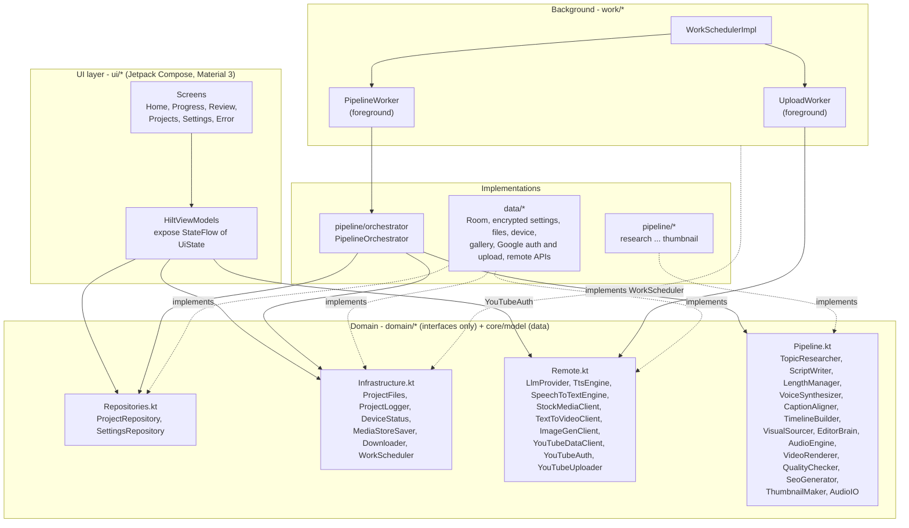
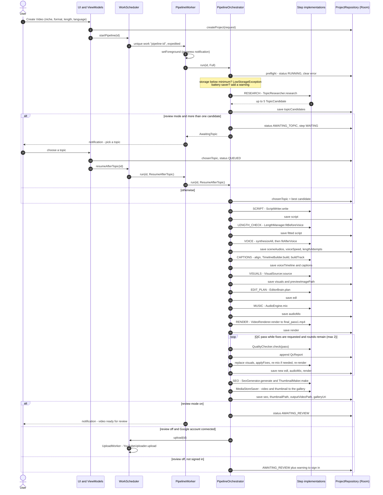
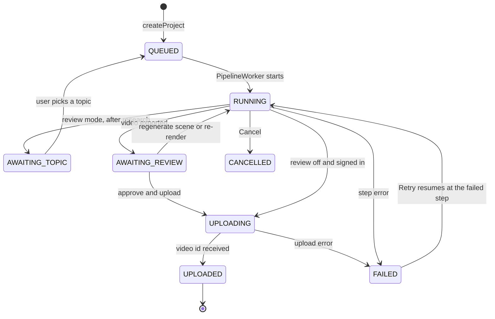
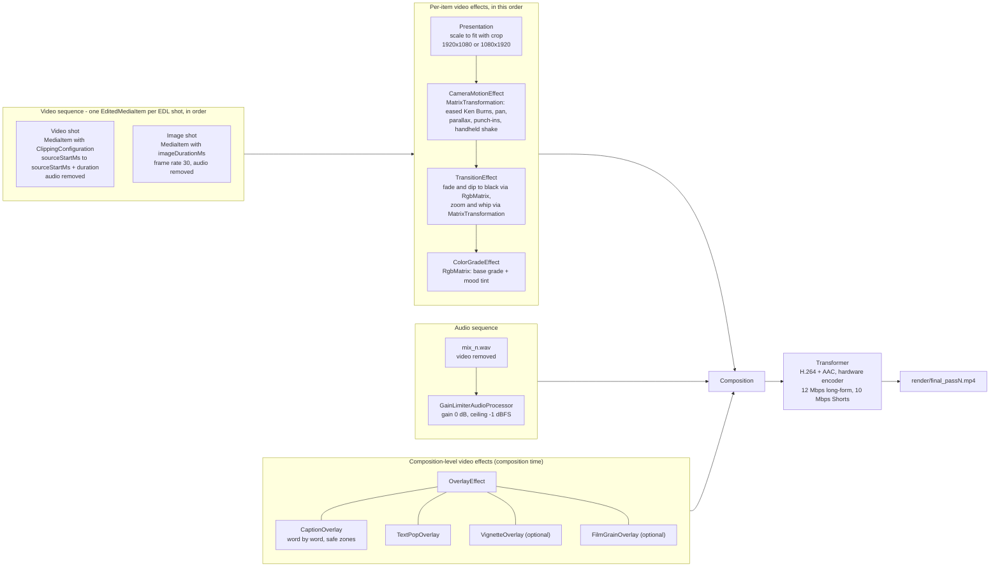
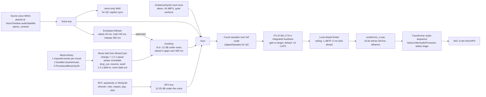

# AutoTube AI - Architecture

This document explains how AutoTube AI is put together: the layers, the dependency-injection
modules, the video pipeline (and how it resumes), the edit decision list (EDL) the AI editor
produces, the Media3 render graph, the audio mixing chain and the offline fallbacks.
For setup and build instructions see the [README](../README.md).

- [1. Layers](#1-layers)
- [2. Package map](#2-package-map)
- [3. Hilt module map](#3-hilt-module-map)
- [4. Persistence and files](#4-persistence-and-files)
- [5. The pipeline](#5-the-pipeline)
- [6. Review mode pause points and project states](#6-review-mode-pause-points-and-project-states)
- [7. Run modes](#7-run-modes)
- [8. The EDL (edit decision list)](#8-the-edl-edit-decision-list)
- [9. Media3 render graph](#9-media3-render-graph)
- [10. Audio mixing chain](#10-audio-mixing-chain)
- [11. Offline fallback matrix](#11-offline-fallback-matrix)
- [12. Background work and notifications](#12-background-work-and-notifications)
- [13. Cross-cutting conventions](#13-cross-cutting-conventions)

---

## 1. Layers

AutoTube AI is a single-module Android app (`:app`, package `com.autotube.ai`) using MVVM with a
thin domain layer of interfaces. Every heavy component sits behind an interface in
`com.autotube.ai.domain`, so the UI, the background workers and each pipeline step only know
about contracts, never about each other's implementation classes.



Rules that keep the layers clean:

- **UI** talks only to `ProjectRepository`, `SettingsRepository`, `WorkScheduler`, `ProjectFiles`,
  `ProjectLogger`, `DeviceStatus` and `YouTubeAuth`. ViewModels expose `StateFlow<UiState>` built
  with `stateIn(WhileSubscribed(5000))`; composables contain no business logic.
- **The UI never runs pipeline work itself.** It writes the request into Room and asks the
  `WorkScheduler` to start, resume, regenerate, re-render, upload or cancel. Everything it shows
  comes from observing the `Project` row, so the screens survive process death and show work that
  is happening in the background.
- **Pipeline steps** depend on domain interfaces only (for example `VisualSourcer` calls
  `StockMediaClient`, `Downloader`, `LlmProvider`), never on another step's class.
- **Models** in `core/model` are immutable `@Serializable` data classes. The whole `Project`
  (including every artifact) is one JSON document, encoded with the shared `AppJson` instance.

## 2. Package map

| Package | Responsibility |
|---|---|
| `core/model` | Serializable domain models: `Enums.kt` (formats, languages, emotions, pipeline steps, statuses), `Settings.kt` (`AppSettings`, `ApiKey`, provider enums), `Models.kt` (request, script, scenes, audio, captions, visuals, QC, SEO, upload options), `Edl.kt` (the edit decision list), `Project.kt` (project, step state, artifacts, errors). |
| `core/common` | `AppJson` + `extractJson`, user-readable exceptions (`PipelineException`, `ApiException`, `MissingApiKeyException`, `NetworkPolicyException`, `LowStorageException`), `withRetry`, `IntentKeys`, `NotificationChannels`. |
| `domain` | Interfaces for everything (see the diagram above) plus small value types (`LlmRequest`, `TtsRequest`, `StockCandidate`, `AuthResult`, `PcmAudio`) and the `completeJson<T>()` helper. |
| `data/local` | Room: `AppDatabase`, `ProjectEntity`, `ProjectDao`, `ProjectRepositoryImpl`. |
| `data/settings` | `SecureSettingsRepository`: `AppSettings` JSON and API keys in EncryptedSharedPreferences. |
| `data/files` | `ProjectFilesImpl` (storage layout), `ProjectLoggerImpl` (per-project log files), `SecretRedactor`. |
| `data/device` | `DeviceStatusImpl`: free storage, power-save mode, connectivity, metered network, battery. |
| `data/media` | `MediaStoreSaverImpl`: saves the video to `Movies/AutoTube AI` and the thumbnail to `Pictures/AutoTube AI`. |
| `data/google` | `YouTubeAuthImpl` (Identity `AuthorizationClient`), `YouTubeUploaderImpl` (resumable upload + thumbnail). |
| `data/remote/http` | The shared OkHttp client factory and HTTP helpers (status code to `ApiException`, header redaction). |
| `data/remote/llm` | `ClaudeLlmClient`, `OpenAiLlmClient`, `OnDeviceLlmClient` (MediaPipe + Gemma), `LlmProviderImpl` (selection and fallback). |
| `data/remote/tts` | `OpenAiTtsEngine`, `ElevenLabsTtsEngine` (with character timestamps). |
| `data/remote/stt` | `WhisperSttEngine` (word timestamps). |
| `data/remote/stock` | `PexelsClient`, `PixabayClient`. |
| `data/remote/aivideo` | `ReplicateTextToVideoClient`, `CustomTextToVideoClient`, shared prediction polling. |
| `data/remote/aiimage` | `OpenAiImageClient`, `ReplicateImageClient`. |
| `data/remote/youtube` | `YouTubeDataClientImpl` (trend research via `search.list` + `videos.list`). |
| `data/remote/download` | `DownloaderImpl` (streamed downloads honouring Wi-Fi only). |
| `pipeline/research` | `TopicResearcherImpl`: trends + ideas, offline idea templates (English and Hindi). |
| `pipeline/script` | `ScriptWriterImpl` + `OfflineScriptTemplates`: scene JSON, rewrite, shorten, expand. |
| `pipeline/length` | `LengthManagerImpl`: duration estimate, allowed window, fit before and after voice. |
| `pipeline/voice` | `VoiceSynthesizerImpl` (engine choice, silence trimming, loudness) and `AndroidTtsEngine` (on-device). |
| `pipeline/captions` | `CaptionAlignerImpl`: Whisper/TTS/estimated word timing, script alignment, caption chunks, emojis. |
| `pipeline/timeline` | `TimelineBuilderImpl`: places scene audio with natural gaps (lead-in, tail). |
| `pipeline/visuals` | `VisualSourcerImpl`, `LocalArtGenerator`, `VisionScorer`, `CinematicPromptBuilder`, `GalleryMediaSource`. |
| `pipeline/editor` | `EditorBrainImpl`, `HeuristicEditPlanner`, `EdlNormalizer`: the AI editor and its rule enforcement. |
| `pipeline/audio` | `AudioIOImpl`, `AudioEngineImpl`, `GainLimiterAudioProcessor`, DSP (`dsp/`), synths (`synth/`), music/SFX library (`library/`). |
| `pipeline/render` | `VideoRendererImpl` (Media3 Transformer) and `effects/` (camera motion, transitions, grade, caption and text-pop overlays, vignette, grain, `TextFit`). |
| `pipeline/qc` | `QualityCheckerImpl`: technical checks + LLM or heuristic "human feel" review with fixes. |
| `pipeline/seo` | `SeoGeneratorImpl`: title, description, chapters, tags, hashtags, thumbnail text. |
| `pipeline/thumbnail` | `ThumbnailMakerImpl`: Canvas thumbnail (1280x720 or 1080x1920 JPEG). |
| `pipeline/orchestrator` | `PipelineOrchestrator`: runs the steps in order, persists artifacts, handles retries, errors, pauses and QC loops. |
| `work` | `PipelineWorker`, `UploadWorker`, `WorkSchedulerImpl`, `NotificationHelper`. |
| `di` | One Hilt module file per area (next section). |
| `ui` | `theme`, `navigation`, `components`, `home`, `progress`, `review`, `projects`, `settings`, `error`. |

## 3. Hilt module map

All modules are `@InstallIn(SingletonComponent::class)` and live in `com.autotube.ai.di`. Each one
binds only the interfaces its own area implements, so no two modules ever bind the same type.

| Module | Binds / provides | Implemented in |
|---|---|---|
| `NetworkModule` | `@Provides` the single `OkHttpClient` (connect 30 s, read/write 10 min, BASIC logging in debug builds with key headers redacted), `Json` (= `AppJson`), `Retrofit.Builder` with the kotlinx-serialization converter | `data/remote/http` |
| `RemoteBindingsModule` | `LlmProvider`, `SpeechToTextEngine`, `YouTubeDataClient`, `Downloader`; map entries `TtsEngine` for `OPENAI` and `ELEVENLABS`; `TextToVideoClient` for `REPLICATE` and `CUSTOM`; `ImageGenClient` for `OPENAI` and `REPLICATE`; set entries `StockMediaClient` (Pexels, Pixabay) | `data/remote/*` |
| `DataModule` | `ProjectRepository`, `SettingsRepository`, `ProjectFiles`, `ProjectLogger`, `DeviceStatus`, `MediaStoreSaver`, `YouTubeAuth`, `YouTubeUploader`; `@Provides` `AppDatabase` (`autotube.db`, destructive migration) and `ProjectDao` | `data/local`, `data/settings`, `data/files`, `data/device`, `data/media`, `data/google` |
| `ContentModule` | `TopicResearcher`, `ScriptWriter`, `LengthManager`, `VoiceSynthesizer`, `CaptionAligner`, `TimelineBuilder`, `SeoGenerator`; map entry `TtsEngine` for `ON_DEVICE` (`AndroidTtsEngine`) | `pipeline/research`, `script`, `length`, `voice`, `captions`, `timeline`, `seo` |
| `AudioModule` | `AudioIO`, `AudioEngine` | `pipeline/audio` |
| `VisualsModule` | `VisualSourcer`, `EditorBrain` | `pipeline/visuals`, `pipeline/editor` |
| `RenderModule` | `VideoRenderer`, `QualityChecker`, `ThumbnailMaker` | `pipeline/render`, `pipeline/qc`, `pipeline/thumbnail` |
| `WorkModule` | `WorkScheduler` | `work` |

Multibindings use the map keys declared in `domain/Remote.kt` and are injected with wildcard
suppression:

```kotlin
// Provider side (example)
@Binds @IntoMap @TtsProviderKey(TtsProviderType.ON_DEVICE)
abstract fun bindOnDeviceTts(impl: AndroidTtsEngine): TtsEngine

// Consumer side
class VoiceSynthesizerImpl @Inject constructor(
    private val engines: Map<TtsProviderType, @JvmSuppressWildcards TtsEngine>,
    /* ... */
)
// Also: Set<@JvmSuppressWildcards StockMediaClient>,
//       Map<TextToVideoProviderType, @JvmSuppressWildcards TextToVideoClient>,
//       Map<ImageGenProviderType, @JvmSuppressWildcards ImageGenClient>
```

`TextToVideoProviderType.NONE` and `ImageGenProviderType.NONE` deliberately have no map entry: a
missing entry means "this source is off" and the sourcer moves to the next fallback.

Other wiring notes:

- `AutoTubeApp` is `@HiltAndroidApp` and implements `Configuration.Provider` with
  `HiltWorkerFactory`; the manifest removes the default `WorkManagerInitializer` so WorkManager is
  initialised on demand with Hilt-injected workers (`@HiltWorker` + `@AssistedInject`).
- `PipelineOrchestrator` needs `WorkScheduler` (to queue an upload) while `WorkScheduler` starts
  workers that use the orchestrator, so the orchestrator takes `dagger.Lazy<WorkScheduler>` to break
  the cycle.
- `MainActivity` is `@AndroidEntryPoint`; ViewModels are `@HiltViewModel` and obtained with
  `hiltViewModel()` from `androidx.hilt.navigation.compose`.

## 4. Persistence and files

**Room** (`autotube.db`, one table). `ProjectEntity` mirrors a few columns for listing and sorting
(`id`, `status`, `niche`, `format`, `title`, `thumbnailPath`, `outputPath`, `createdAt`,
`updatedAt`) and stores the complete `Project` as a JSON blob (`json`) encoded with `AppJson`.
`ProjectRepository.updateProject(id) { ... }` is an atomic read-modify-write guarded by a `Mutex`,
which is how every step saves its artifact. Rows whose JSON cannot be decoded are skipped (and
logged) instead of crashing the list. `AppJson` ignores unknown keys and every model field has a
default, so older projects keep decoding when models gain fields.

**Settings** (`SecureSettingsRepository`). EncryptedSharedPreferences file `autotube_secure`
(AES-256 GCM master key in the Android Keystore). Non-secret settings are one `AppSettings` JSON
value; each API key is a separate `key_<NAME>` entry and never becomes part of `AppSettings`, the
database or a log. If the encrypted store cannot be opened (keystore corruption on some devices)
it is recreated once and, as a last resort, replaced by private app storage with a logged warning.

**Files** (`ProjectFiles`), all app-private:

```
filesDir/
├── projects/<id>/
│   ├── audio/      scene_<n>_v<k>.wav voice files (versioned, regenerations never collide)
│   ├── visuals/    downloaded stock clips, AI clips/images, on-device art, preview JPEGs
│   ├── render/     mix_<n>.wav, final_pass<N>.mp4, thumbnail.jpg
│   ├── temp/       scratch space, wiped by clearTemp()
│   └── logs/       project.log (rotated to project.log.1 above 2 MB)
├── music/<emotion>/   tracks you import per mood in Settings
└── models/            imported MediaPipe .task models
cacheDir/<id>/         per-project cache, wiped by clearTemp()
```

Finished files are also copied to the shared gallery through MediaStore: the video to
`Movies/AutoTube AI`, the thumbnail to `Pictures/AutoTube AI`. With "Delete temp files after
export" on, `clearTemp(keepFinal = true)` runs after the export and superseded QC render passes are
deleted.

Backups: `android:allowBackup="false"` and `data_extraction_rules.xml` exclude every domain from
cloud backup and device transfer, so keys and projects never leave the phone that way.

## 5. The pipeline

### 5.1 Step order and artifacts

`PipelineStep` defines the execution order. Each step's result is written into the `Project`
before the next one starts, which is what makes the pipeline resumable.

| # | Step (`PipelineStep`) | UI stage | Interface | Artifact persisted on the `Project` | Weight |
|---|---|---|---|---|---|
| 1 | `RESEARCH` | Research | `TopicResearcher` | `topicCandidates` (best first, max 5), `chosenTopic` | 0.05 |
| 2 | `SCRIPT` | Script | `ScriptWriter` | `script` (scenes with role, emotion, intensity, keywords) | 0.08 |
| 3 | `LENGTH_CHECK` | Length check | `LengthManager.fitBeforeVoice` | `script` (shortened or expanded to the window) | 0.04 |
| 4 | `VOICE` | Voice | `VoiceSynthesizer` + `LengthManager.fitAfterVoice` | `artifacts.sceneAudios`, `artifacts.voiceSpeed`, `artifacts.lengthAttempts`, `script` | 0.15 |
| 5 | `CAPTIONS` | Voice | `CaptionAligner` + `TimelineBuilder` | word timings in `sceneAudios`, `artifacts.voiceTimeline`, `artifacts.captions` | 0.05 |
| 6 | `VISUALS` | Editing | `VisualSourcer` | `artifacts.visuals`, `previewImagePath` | 0.20 |
| 7 | `EDIT_PLAN` | Editing | `EditorBrain.plan` | `artifacts.edl` | 0.05 |
| 8 | `MUSIC` | Music | `AudioEngine.mix` | `artifacts.audioMix` (`render/mix_<n>.wav`) | 0.06 |
| 9 | `RENDER` | Editing | `VideoRenderer` | `artifacts.render` (`render/final_pass<N>.mp4`), `artifacts.renderPasses` | 0.22 |
| 10 | `QUALITY_CHECK` | Editing | `QualityChecker` (+ `EditorBrain.applyFixes`, re-mix, re-render) | `qcReports`, updated `edl`/`audioMix`/`render` | 0.07 |
| 11 | `SEO` | Editing | `SeoGenerator` + `ThumbnailMaker` + `MediaStoreSaver` | `seo`, `thumbnailPath`, `outputVideoPath`, `galleryUri` | 0.03 |
| 12 | `UPLOAD` | Upload | `YouTubeUploader` (in `UploadWorker`) | `uploadProgress`, `youtubeVideoId` | tracked separately |

Every step records a `StepState` (`PENDING`, `RUNNING`, `DONE`, `SKIPPED`, `WAITING`, `FAILED`)
with progress, a message, attempt count and timestamps. `overallProgress` is the weighted sum.
Progress is persisted at most about every 700 ms (always at step boundaries) to avoid database
churn while the Progress screen still animates smoothly.

### 5.2 Sequence



### 5.3 Resumability

- A step whose artifact already exists is **SKIPPED** unless the run mode invalidates it. Retrying
  from the Error screen calls `WorkScheduler.startPipeline(id)`, which therefore resumes at the step
  that failed instead of starting over (no second bill for a script or voiceover you already have).
- Each step runs inside `withRetry(3)` for retryable failures (I/O errors, HTTP 408/409/429/5xx)
  with exponential backoff and jitter; retries are logged.
- On a non-retryable failure the orchestrator stores a `PipelineError` (step, readable title and
  message, technical details) and sets the step and project to `FAILED`. `PipelineException`
  subclasses supply the user-facing wording; anything else gets a readable per-step message.
- On cancellation the project is marked `CANCELLED` inside `NonCancellable` and the
  `CancellationException` is rethrown.
- QC re-renders write `final_pass<N>.mp4`; the render with the best human-feel score is kept as
  the output and superseded passes are deleted when temp cleanup is on.

## 6. Review mode pause points and project states

With **Review mode** on (the default) the pipeline stops twice for a human decision:

1. **After research** (`AWAITING_TOPIC`): when there is more than one candidate, the Progress screen
   shows the top 5 ideas with score and reason. Picking one saves `chosenTopic` and calls
   `WorkScheduler.resumeAfterTopic(id)`.
2. **After export** (`AWAITING_REVIEW`): the Review screen plays the video and lets the user edit
   title, description, tags and hashtags, look at the QC report, regenerate individual scenes,
   re-render, choose Publish now / Schedule / Private, and finally approve the upload (Google
   authorization happens here, then `WorkScheduler.upload(id)`).

With Review mode off, research takes the best idea automatically and, if a Google account is
connected, the upload is queued straight after export using the default upload mode.



`ProjectStatus.isActive` (`QUEUED`, `RUNNING`, `UPLOADING`) drives progress bars and the Cancel
button. Notifications deep-link with `IntentKeys.EXTRA_PROJECT_ID` and `EXTRA_DESTINATION`
(`progress`, `review`, `error`).

## 7. Run modes

`PipelineOrchestrator.run(projectId, mode, progressSink)` supports four modes; the worker receives
the mode (and scene number) through its input data.

| Mode | Triggered by | What it recomputes |
|---|---|---|
| `Full` | `startPipeline` (Create, Retry) | Every step whose artifact is missing |
| `ResumeAfterTopic` | `resumeAfterTopic` | Continues from `SCRIPT` with the chosen topic |
| `RegenerateScene(n)` | Review, "Regenerate" on a scene | Rewrites scene *n* (fresh angle, same role and length), re-voices it at the stored `voiceSpeed`, re-aligns, rebuilds the timeline and captions, sources new visuals for scene *n* only, re-plans the edit, re-mixes, re-renders, runs one QC pass, keeps the SEO, remakes the thumbnail, saves to the gallery, then `AWAITING_REVIEW` |
| `Rerender` | Review, "Re-render" | Re-mix and re-render with the current EDL, plus one QC pass |

Regenerate and re-render use `ExistingWorkPolicy.REPLACE`; start and resume use `KEEP`, so tapping
twice never runs two pipelines for the same project.

## 8. The EDL (edit decision list)

The `EditDecisionList` (`core/model/Edl.kt`) is the AI editor's complete plan. It is produced by
`EditorBrain.plan()` (LLM, or `HeuristicEditPlanner` offline), always passed through
`EdlNormalizer`, consumed by `AudioEngine` (music and SFX cues) and `VideoRenderer` (shots, text
pops, looks), and patched by `EditorBrain.applyFixes()` after QC.

**Time base.** All `startMs`/`endMs`/`atMs` values are absolute milliseconds on the final video
timeline (0 = first frame). `Shot.sourceStartMs` is the read position inside the source clip.
Word timings in `SceneAudio.words` are relative to their scene WAV; `CaptionWord` times are
absolute.

**Example** (the first ~10 s of a Short; JSON exactly as serialized by `AppJson`):

```json
{
  "style": "fast_shorts",
  "totalMs": 9800,
  "shots": [
    {
      "index": 0,
      "sceneNumber": 1,
      "startMs": 0,
      "endMs": 2350,
      "assetId": "pexels_video:3129671",
      "sourceStartMs": 1200,
      "shotType": "wide",
      "motion": {
        "type": "ken_burns_in", "zoomStart": 1.0, "zoomEnd": 1.04,
        "panStartX": 0.0, "panStartY": 0.0, "panEndX": 0.0, "panEndY": 0.0,
        "easing": "ease_in_out", "shake": 0.12, "shakeSeed": 9134
      },
      "transitionIn": "cut",
      "transitionMs": 0,
      "cutType": "straight",
      "isBroll": false,
      "isPatternInterrupt": false,
      "punchIns": [],
      "reason": "Hook opens on a wide establishing clip with a slow push-in"
    },
    {
      "index": 1,
      "sceneNumber": 1,
      "startMs": 2350,
      "endMs": 4900,
      "assetId": "ai_image:scene1_1",
      "sourceStartMs": 0,
      "shotType": "close_up",
      "motion": {
        "type": "ken_burns_in", "zoomStart": 1.0, "zoomEnd": 1.14,
        "panStartX": -0.2, "panStartY": 0.0, "panEndX": 0.1, "panEndY": 0.0,
        "easing": "ease_out", "shake": 0.0, "shakeSeed": 4410
      },
      "transitionIn": "cut",
      "transitionMs": 0,
      "cutType": "straight",
      "isBroll": false,
      "isPatternInterrupt": true,
      "punchIns": [
        { "atMs": 3700, "durationMs": 700, "scale": 1.1, "word": "million" }
      ],
      "reason": "Angle change to a close-up and punch-in on the number (pattern interrupt)"
    },
    {
      "index": 2,
      "sceneNumber": 2,
      "startMs": 4900,
      "endMs": 9800,
      "assetId": "local:s2_0",
      "sourceStartMs": 0,
      "shotType": "medium",
      "motion": {
        "type": "pan_left", "zoomStart": 1.08, "zoomEnd": 1.08,
        "panStartX": 0.6, "panStartY": 0.0, "panEndX": -0.6, "panEndY": 0.0,
        "easing": "ease_in_out", "shake": 0.0, "shakeSeed": 771
      },
      "transitionIn": "whip",
      "transitionMs": 320,
      "cutType": "l_cut",
      "isBroll": true,
      "isPatternInterrupt": false,
      "punchIns": [],
      "reason": "Section change into the intro: whip, the hook's last words carry over (L-cut)"
    }
  ],
  "textPops": [
    {
      "text": "3 MILLION", "startMs": 3780, "endMs": 5100, "kind": "number",
      "emoji": "🤯", "sceneNumber": 1, "reason": "Pops exactly when the number is spoken"
    }
  ],
  "sfx": [
    { "type": "pop", "atMs": 3780, "gain": 0.35, "reason": "Text pop" },
    { "type": "whoosh", "atMs": 4900, "gain": 0.45, "reason": "Whip transition" }
  ],
  "music": [
    { "atMs": 0, "action": "change", "emotion": "suspense", "intensity": 7, "durationMs": 0, "reason": "Hook mood" },
    { "atMs": 3200, "action": "drop_out", "emotion": "suspense", "intensity": 7, "durationMs": 500, "reason": "Silence before the reveal" },
    { "atMs": 3800, "action": "resume", "emotion": "suspense", "intensity": 7, "durationMs": 0, "reason": "Back in on the reveal" },
    { "atMs": 4900, "action": "change", "emotion": "exciting", "intensity": 6, "durationMs": 1500, "reason": "Scene 2 is upbeat" }
  ],
  "sceneLooks": { "1": "suspense", "2": "exciting" },
  "notes": "Fast Shorts style: cuts on breaths, one pattern interrupt every 5-10 s"
}
```

**Field reference**

| Object | Field | Meaning |
|---|---|---|
| EDL | `style` | `documentary`, `fast_shorts` or `calm_educational` |
| EDL | `totalMs` | Length of the timeline (= `VoiceTimeline.totalMs`) |
| EDL | `sceneLooks` | Scene number to emotion; the renderer applies one base grade plus this mood tint |
| Shot | `assetId` | A `VisualAsset.id`: `pexels_video:<id>`, `pixabay_photo:<id>`, `ai_image:...`, `local:s<scene>_<slot>`, ... |
| Shot | `motion` | `type` (`static`, `ken_burns_in/out`, `pan_left/right/up/down`, `parallax`), zoom start/end (1.0 = frame-filling crop), normalized pan (-1..1 of the margin), `easing` (`ease_in_out`, `ease_out`, `ease_in`), handheld `shake` 0..1 with a per-shot seed |
| Shot | `transitionIn` | `cut` (default), `fade`, `dip_to_black`, `zoom`, `whip`; `transitionMs` 250-600 for non-cuts |
| Shot | `cutType` | `straight`, `j_cut` (next audio starts before its picture), `l_cut` (previous audio continues over the new picture) |
| Shot | `punchIns` | Eased 1.05-1.15 scale bumps on key words (`atMs` absolute) |
| TextPop | `kind` | `number`, `name`, `fact`, `title`, `cta`; always drawn inside the safe zones |
| SfxCue | `type` | `whoosh`, `riser` (peaks at `atMs`), `impact`, `pop`, `click`, `swoosh_soft`; `gain` 0..1 on the SFX bus |
| MusicCue | `action` | `change` (crossfade to a track for `emotion`/`intensity`), `drop_out`, `resume`, `swell` |

**Rules enforced by `EdlNormalizer`** (whatever produced the plan):

- Shots tile `[0, totalMs)` exactly, sorted, no gaps or overlaps; every `assetId` exists; video
  segments fit inside their source clip.
- Human pacing: shot lengths vary naturally (about 2-6 s, 1.5-4 s in high-intensity Shorts), faster
  in exciting or dramatic parts, longer in calm ones, never a fixed rhythm.
- Cuts land on pauses, breaths or word boundaries, never inside a word.
- J/L cuts at scene boundaries offset the picture 200-600 ms from the audio boundary.
- A pattern interrupt every 5-10 s (Shorts) or 20-40 s (long-form): punch-in, shot-type change,
  B-roll or text pop.
- About 85-95 % hard cuts; fancy transitions only at section changes and never two in a row.
- Images always move (eased Ken Burns, pans, parallax); videos stay mostly static; light handheld
  shake on some shots only (when enabled); no linear easing.
- No image is reused; a video is reused only for a non-overlapping segment; shot types alternate.
- Text pops for numbers, names and key facts exactly when spoken, 0.9-2.0 s, never overlapping.
- Sound design: subtle whoosh on non-cut transitions, pop on text pops, impacts and a few risers on
  big moments; music changes when the scene emotion changes, drops out before the most important
  line, swells in gaps of 800 ms or more.

## 9. Media3 render graph

`VideoRendererImpl` builds **one** `Composition` for Media3 Transformer 1.8.0 and exports H.264
video + AAC audio with the device's hardware encoders.



Details and fallbacks:

- **Timing inside per-item effects.** Presentation timestamps of a sequence item may be offset, so
  each effect latches the first timestamp it sees and computes progress relative to it (clamped to
  0..1). Composition-level overlays use composition time, which is 0-based.
- **Outgoing transitions.** A fade or dip into shot *n* is mirrored by a fade-out at the end of
  shot *n-1*; there are no overlapping items.
- **Caption bitmaps** are full-frame ARGB overlays redrawn only when the visible state changes (chunk,
  active word, animation bucket). Safe zones: Shorts text stays between about 20 % and 70 % of the
  height and away from the right-hand action rail; long-form captions sit bottom-centre inside the
  90 % action-safe width. `TextFit.measureOverflow` is shared with QC.
- **Fallback 1:** if composition-level effects fail on a device, overlays are applied per item with
  each shot's time offset.
- **Fallback 2:** if the two-sequence export fails, the video is rendered alone, the WAV is encoded
  to AAC in a second audio-only export, and both are muxed with `MediaExtractor` + `MediaMuxer`
  (`RenderResult.usedFallbackMuxing = true`).
- **Fallback 3:** if the encoder rejects 1080p, the render is retried once at 720p with a lower
  bitrate.
- Transformer runs on the main thread (it needs a Looper); progress is polled every 500 ms through
  `ProgressHolder`; coroutine cancellation calls `Transformer.cancel()`.
- The output is verified (duration and size via `MediaMetadataRetriever`) before `RenderResult` is
  returned.

## 10. Audio mixing chain

`AudioEngineImpl.mix()` produces one loudness-normalized stereo WAV at 48 kHz. Voice files come
from `VoiceSynthesizer` already cleaned up (48 kHz mono, trimmed silences, 80 Hz high-pass, peak
normalized to -3 dBFS).



- Music level follows scene intensity and the **Music volume** setting; the bed changes only when
  the scene emotion changes (if the EDL has no music cues, they are derived from scene emotions).
- SFX and ambience respect the **Sound effects** and **Ambient room tone** settings.
- Memory: a 10-minute stereo float buffer is about 230 MB, so the engine mixes music and SFX
  directly into the output buffer and never holds more than about two full-length buffers.
- `AudioMixResult` reports `integratedLufs`, `truePeakDbfs` and `clippedSamples`; QC flags clipping,
  a true peak above -0.5 dBFS and loudness more than 1.5 LU away from the target.
- `GainLimiterAudioProcessor` (`pipeline/audio`) is a Media3 `BaseAudioProcessor` that accepts
  16-bit and float PCM and applies gain plus a soft-knee limiter, so the encoder never sees overs.

## 11. Offline fallback matrix

With no API keys (or with **Run fully offline** on) every step except the upload still works on
the phone.

| Step | Online provider(s), in order of preference | Offline / on-device fallback |
|---|---|---|
| Research | YouTube Data API v3 trends (`search.list` + `videos.list`) + Claude or OpenAI for ideas | On-device Gemma brainstorm from the niche, else templated angles in English and Hindi ("N surprising facts about X", "Why X ...", Hindi equivalents) |
| Script | Claude (default `claude-opus-5-5`) or OpenAI (`gpt-4o`) | On-device Gemma (MediaPipe `.task` model), else `OfflineScriptTemplates` (hook, intro, 3-8 main points, CTA) |
| Length check | LLM shorten / expand / rewrite scene | Template drop or duplicate-with-variation of main points; pitch-preserving speed change (Sonic) and pause trimming are always on-device |
| Voice | OpenAI TTS (`gpt-4o-mini-tts`), ElevenLabs (`eleven_multilingual_v2`) | Android `TextToSpeech` (installed engine, e.g. Speech Services by Google), with word timings from `onRangeStart` |
| Captions | OpenAI Whisper word timestamps, aligned to the script | TTS engine word timings, else timing estimated from word length and detected pauses |
| Visuals | Pexels / Pixabay stock video, Replicate or custom text-to-video, stock photos, OpenAI or Replicate images | Your gallery photos and videos (optional), then `LocalArtGenerator` (procedural gradients, bokeh, light streaks, keyword typography) |
| Vision match check | Claude or OpenAI vision | Skipped; shot types from keyword heuristics |
| AI editor plan | LLM writes the EDL | `HeuristicEditPlanner`; `EdlNormalizer` runs in both cases |
| Music and SFX | none (no online music API is used) | Tracks you import per mood, bundled `assets/music` and `assets/sfx`, else `ProceduralMusicSynth`, `SfxSynth`, `AmbienceSynth` |
| Mix and render | none | Always on-device (DSP + Media3 Transformer) |
| Quality check | LLM "human feel" and pacing review | Technical checks always on-device; heuristic scores and fixes |
| SEO | LLM title, description, tags, hashtags | Built from the script; chapters are always computed deterministically from the timeline |
| Thumbnail | none | Always on-device (Canvas) |
| Upload | YouTube Data API v3 resumable upload (OAuth) | No offline path: the video is saved to the gallery for a manual upload later |

`LlmProvider.text()` picks the LLM per call: with **Run fully offline** on, only the on-device
model (if imported) is used; otherwise the provider chosen in Settings if usable, then Claude,
OpenAI, on-device, and finally `null` (templates). `LlmProvider.vision()` never runs offline.

## 12. Background work and notifications

- `PipelineWorker` (`@HiltWorker` `CoroutineWorker`) calls `setForeground()` immediately with an
  ongoing progress notification on the `pipeline_progress` channel (title, current step, progress,
  Cancel action via `WorkManager.createCancelPendingIntent`). Foreground service type: media
  processing + data sync on Android 15+, data sync on Android 10-14 (the manifest declares
  `dataSync|mediaProcessing` for `SystemForegroundService`). Notification updates are throttled to
  at most one per second.
- Requests are expedited (`RUN_AS_NON_EXPEDITED_WORK_REQUEST` when out of quota), require storage
  not low, and require a connected network unless **Run fully offline** is on.
- `UploadWorker` runs as a separate unique work (`upload-<id>`), constrained to an unmetered network
  when **Wi-Fi only** is on, with exponential backoff (30 s). The resumable upload sends 8 MB chunks
  and resumes after 308/5xx/network errors; a 401 triggers one token refresh through `YouTubeAuth`.
- Final notifications go to the `pipeline_alerts` channel: pick a topic, review ready, failed (opens
  the Error screen), uploaded (with an "Open on YouTube" action).
- Workers return `Result.success()` for every handled outcome; failures are shown on the project
  (Error screen) rather than through WorkManager retries.

## 13. Cross-cutting conventions

- **Threads:** blocking I/O on `Dispatchers.IO`; DSP and bitmap drawing on `Dispatchers.Default`;
  Media3 Transformer on `Dispatchers.Main`; MediaPipe inference on `Dispatchers.Default`.
- **JSON:** one `AppJson` instance everywhere (`ignoreUnknownKeys`, lenient, defaults encoded). LLM
  calls go through `LlmProvider` and `completeJson<T>()`, which strips prose and code fences
  (`extractJson`) and re-asks once with the parser error if the JSON does not decode.
- **Errors:** throw `PipelineException` (or a subclass) with wording a non-technical user
  understands; `ApiException` maps HTTP codes to messages and decides retryability;
  `CancellationException` is never swallowed.
- **Logging:** each step receives a `StepLogger` bound to the project; lines are written to
  `projects/<id>/logs/project.log` and Logcat (tag `AutoTube`). API keys and tokens are redacted
  before anything is written; OkHttp logging is BASIC and debug-only with key headers redacted.
- **Languages:** `AppLanguage.ENGLISH` (`en-US`) and `AppLanguage.HINDI` (`hi-IN`) work end to end:
  Devanagari scripts, language-aware speaking rates (about 150 wpm English, 130 wpm Hindi) and
  word timing, captions in Devanagari with system Noto fonts, Hindi SEO with mixed Hindi + English
  tags. Stock search keywords stay in English for better results.
- **Opt-ins** (`UnstableApi`, `ExperimentalMaterial3Api`, `ExperimentalSerializationApi`,
  `ExperimentalCoroutinesApi`) are enabled globally in `app/build.gradle.kts`.
