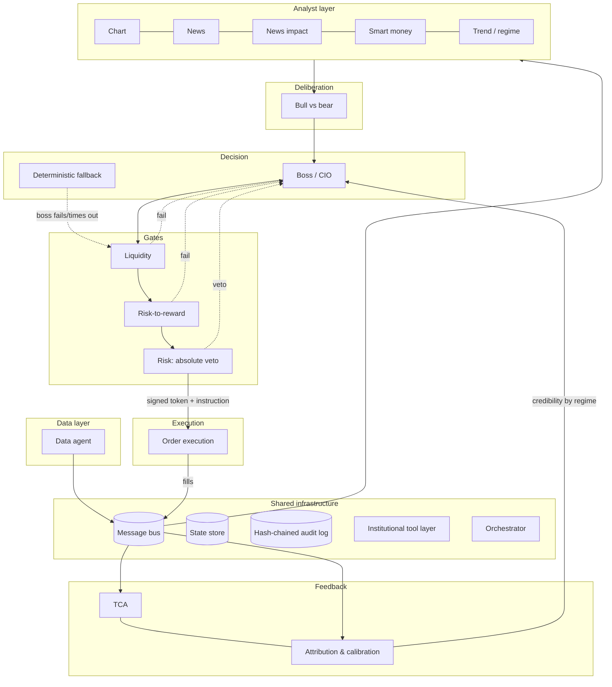
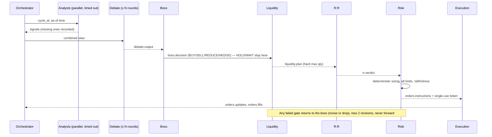

# Architecture: Multi-Agent AI Trading System

Status: **Phase 3 done** (event-driven backtester, walk-forward validation), awaiting review.
Phase reports: [PROGRESS.md](PROGRESS.md).
Scope assumed for Phase 1: NSE cash plus F&O, swing horizon, Zerodha Kite Connect, Python 3.11+.
Every assumption is listed in [DECISIONS.md](DECISIONS.md) and is config-driven.

---

## 1. Principles and where each one is enforced

| # | Principle | Enforcement mechanism | Verified by |
|---|-----------|-----------------------|-------------|
| 1 | LLMs research and judge; they never sit in the execution hot path or do arithmetic | Agent specs mark LLM agents, which cannot publish on gate, risk or order topics (`TOPIC_PUBLISHERS`). The boss outputs a *risk-budget fraction* and deterministic sizing computes quantities | `test_agent_registry.py::test_llm_agents_never_touch_gates_or_orders`, `test_unauthorised_publishers_are_rejected` |
| 2 | Risk limits, sizing and execution are deterministic | Liquidity, R:R, risk, execution and orchestrator are `DETERMINISTIC`. Limits are validated on load (`config/settings.py`) | `test_gates_and_execution_are_deterministic`, `test_config.py` |
| 3 | Everything logged immutably and replayably | Every envelope, LLM call (full prompt, model, seed), tool call, config snapshot and human action goes to a hash-chained append-only log (`audit/chain.py`). The bus audits before delivery, and `ToolRunner` audits every call, failures included | `test_audit.py`, `test_bus.py`, `test_runner_audits_success_and_failure` |
| 4 | Point-in-time correctness | Envelope requires `event_time <= available_at <= produced_at`. The bitemporal store (`storage/pit.py`) reads as of `available_at`. Corporate actions are adjusted only once known. Pivots carry `confirmed_at` | `test_lookahead_survivorship.py`, `test_pit_store.py` |
| 5 | External text is untrusted | Strict schemas with `extra="forbid"`. Claims must quote a source document. Prompts wrap external text in data blocks. Outputs must parse or are discarded | `test_news_schemas.py`, `test_free_text_payload_is_rejected` |
| 6 | Safe degradation | Every spec declares a `FailureMode`. Missing agents apply limit multipliers. Safety-critical components `FREEZE` | `test_safety_critical_components_freeze_on_failure`. Phase 5: failure-injection tests |
| 7 | Staged rollout | `stage` in config; paper/live require durable backends; risk rule `STAGE_NOT_PERMITTED` | `test_paper_and_live_need_durable_backends` |

## 2. Layers and decision flow



### Decision cycle



**Failed gates.** A rejection at liquidity, R:R or risk goes back to the boss as a request to revise
or drop. `revision_of` and `revision_number` link the attempts. The revision cap is 2, after which
the decision becomes WAIT.

**HOLD and WAIT** produce no instructions (enforced in `UnsignedInstruction`). HOLD keeps
existing positions and their broker-side protective stops.

## 3. Components

| Agent | Kind | Publishes | Failure mode |
|-------|------|-----------|--------------|
| Data | deterministic | `data.*`, `risk.alerts` | FREEZE (data failure alert) |
| Chart | deterministic | `signals.chart` | SKIP (no levels → R:R cannot pass) |
| News | hybrid (LLM extraction) | `news.events`, `news.risk_flags` | SKIP (calendar flags still apply) |
| News impact | deterministic | `news.impact` | SKIP (generic stress scenarios) |
| Smart money | deterministic | `signals.smartmoney` | SKIP |
| Trend / regime | hybrid | `regime.outlook`, `news.risk_flags` | FALLBACK (regime UNKNOWN, stricter multiplier) |
| Debate (bull, bear) | LLM | `debate.output` | SKIP (boss conviction capped) |
| Boss | LLM | `boss.decision` | FALLBACK (rule set, ≤ 50% risk budget) |
| Liquidity | deterministic | `liquidity.plan` | BLOCK_TRADE |
| Risk-to-reward | deterministic | `rr.verdict` | BLOCK_TRADE |
| Risk | deterministic | `risk.approval`, `orders.instructions`, `risk.alerts` | FREEZE (nothing can be approved) |
| Execution | deterministic | `orders.updates`, `orders.fills`, `risk.alerts` | FREEZE |
| Orchestrator | deterministic | `system.heartbeat`, `risk.alerts` | FREEZE |
| TCA, attribution | deterministic | `tca.results`, `feedback.scores` | SKIP |

The full contracts (responsibility, consumed and published topics, tools, timeouts, metrics) are
the `SPEC` objects in each package, collected in `agents/registry.py`.

**Why most analysts are deterministic.** Chart structure, event studies, flow scores and
liquidity are numeric. LLMs are used only where language or judgment is the actual job: news
extraction, regime narrative, debate and the CIO decision. This keeps cost, latency and
non-determinism where they add value.

## 4. Communication

**Envelope** (`schemas/envelope.py`). Every message carries: `message_id`, `schema_version`,
`topic`, `agent_id`, `cycle_id`, `causation_ids`, `event_time`, `available_at`,
`produced_at`, `priority` and a typed `payload`. The payload is a discriminated union on `kind`.
The envelope validator enforces:

- the payload type matches the topic;
- the publisher is authorised for the topic (authority hierarchy);
- `event_time <= available_at <= produced_at` (no lookahead);
- `risk.alerts` are always `INTERRUPT` priority;
- the schema major version is compatible.

**Topics:** `data.bars`, `data.corporate_actions`, `data.quality`, `signals.chart`,
`signals.smartmoney`, `news.events`, `news.risk_flags`, `news.impact`, `regime.outlook`,
`debate.output`, `boss.decision`, `liquidity.plan`, `rr.verdict`, `risk.approval`,
`risk.alerts`, `orders.instructions`, `orders.updates`, `orders.fills`, `tca.results`,
`feedback.scores`, `system.heartbeat`.

**Delivery** (`bus/interface.py`). At-least-once delivery, so consumers dedupe on `message_id`.
Interrupts jump the queue. Ordering is guaranteed per topic only. Publishing writes the audit log
first and validates the envelope; an invalid envelope is never delivered. Backends: in-memory for
tests and backtests, Redis Streams (consumer groups) for paper and live.

**Patterns.** Broadcast for context (regime, risk flags). Request/response for gates, correlated
by `decision_id` and `cycle_id`. Interrupts for alerts and the kill switch.

## 5. Approval tokens and the no-bypass guarantee

1. The risk agent builds the `UnsignedInstruction` itself: approved quantity, liquidity plan,
   protective stop and idempotency key.
2. It computes `digest = sha256(canonical_json(instruction))` and issues an `ApprovalToken`
   containing `token_id`, `decision_id`, `instruction_digest`, `issued_at`, `expires_at`
   (TTL 300 s), `key_id`, and an HMAC-SHA256 `signature` keyed by `AITRADER_RISK_SIGNING_KEY`.
3. `OrderInstruction` refuses to construct if the token's digest or decision does not match. Any
   change to quantity, price, side, stop or key after approval invalidates it (tested).
4. Execution verifies the HMAC and expiry, then atomically consumes `token_id`
   (`StateStore.consume_token`) and claims the `idempotency_key` before any broker call.
5. The broker adapter is private to the execution package. Its only public entry point is
   `execute(OrderInstruction)`, which performs steps 4 and 5 and checks the freeze flag. A
   Phase 6 static test fails CI if any module outside `execution/` imports the broker client.
6. The kill switch is a `risk.alerts` interrupt (`KILL_SWITCH`). It sets the freeze flag in the
   state store, which execution checks before every child order. Only a human action can clear it
   (`clear_freeze(cleared_by_human=True)`). A file-based switch also works when the bus is down.

## 6. Orders

- State machine: `pending → placed → partially_filled → filled`, with `cancelled` and
  `rejected` as terminal states. Transitions are validated (`ALLOWED_TRANSITIONS`, `OrderUpdate`).
- One idempotency key per instruction leg. Child orders use `<key>:<slice>` as the broker order
  tag. Retries after a timeout first query the broker by tag and never blindly re-send.
- Fills are deduplicated on `broker_trade_id`.
- Reconciliation runs every 60 s comparing positions and orders with the broker. Any mismatch
  raises `RECONCILIATION_MISMATCH`, which freezes trading.
- Sanity caps: order value, order rate (≤ broker OPS cap), and price deviation from the last
  traded price. Freeze-quantity splits for F&O. Market orders are disabled by default.

## 7. Point-in-time data

- **Bitemporal storage.** Every record keeps `event_time` (when it happened or was published at
  the source), `available_at` (when the system could first know it, including vendor and exchange
  publication lag) and `ingested_at`. Reads are always `as_of(available_at <= t)`.
- **Lagged sources get true availability.** FII/DII and participant OI are published after the
  close. Shareholding data is quarterly with a filing lag. Fundamentals become available at the
  filing timestamp, not the period end.
- **Corporate actions** are applied as of the backtest clock. A split announced after `t` must
  not adjust prices seen at `t`. `Bar.adjustment_factor` records what was applied.
- **Survivorship.** Historical index and universe membership is used, with delisted and renamed
  symbols mapped through `CorporateActionType.DELISTING` and `SYMBOL_CHANGE`.
- Phase 2 and 3 add explicit tests: a planted future record is never visible to an as-of read,
  backtest results are unchanged when future data is deleted, and delisted names stay in the
  universe on dates they traded.

## 8. LLM usage

- Models are pinned by exact id in `system.yaml`. `LlmConfig.require_pinned()` refuses
  placeholders and `*-latest` aliases before any LLM agent starts. Temperature defaults to 0.
- Prompts are versioned files in `src/aitrader/prompts/` and never edited in place. Every call
  logs the prompt id, version, hash, full rendered text, seed, tokens and cost (`LlmCallRecord`).
- Output must parse into the agent's schema. An unparseable output counts as an agent failure,
  never as a retry-until-it-agrees loop.
- External text appears only inside delimited data blocks. Schemas have no free-text
  "instruction" channel, and the extracted claims must quote the source span. That span is
  verified against the stored document by a deterministic tool (`news.verify_excerpt`).
- Numbers in LLM outputs must reference tool calls (`EvidenceKind.TOOL_CALL`). The boss cannot
  emit a quantity, only a `risk_budget_fraction` in [0, 1].
- Budgets: a per-cycle call cap and a daily USD cap. Breaching a budget degrades to the
  deterministic fallback.

## 9. Degradation matrix

| Failure | Behaviour |
|---------|-----------|
| One analyst times out | Cycle proceeds; limit multiplier ×0.75 per missing agent; no new entries below 3 live analysts |
| Trend agent missing | Regime `UNKNOWN`, multiplier ×0.5, exposure targets cannot rise |
| Debate missing | Boss decides, conviction capped |
| Boss fails or times out | Deterministic fallback, ≤ 50% risk budget, flagged `used_fallback` |
| Liquidity or R:R missing | Trade dropped |
| Risk agent down | Nothing can be approved, so no new orders; freeze alert on heartbeat loss |
| Data feed stale | `DATA_FAILURE` freeze for new entries; broker-side stops remain |
| Broker disconnect | Freeze; on reconnect, reconcile before unfreezing (human clears) |
| Reconciliation mismatch | Freeze; human clears |
| Duplicate or replayed message | Deduped on `message_id`; instruction replays rejected by single-use token and idempotency key |
| Drawdown breach | Daily: freeze new entries for the day. Total: freeze and run the flatten runbook. Human clears |

## 10. Risk framework

Limits live in `config/limits.yaml` and are validated for coherence on load (for example,
daily < total drawdown and net ≤ gross). They cover:

- per-trade risk (1%, hard cap 2% in code) and position (10%);
- gross and net exposure, sector, correlation cluster, leverage and number of positions;
- daily and total drawdown (3% / 10%), with progressive tightening from 50% of a limit;
- liquidity (≤ 5% ADV, participation ≤ 10%, ≤ 1 day to liquidate);
- VaR and CVaR at 99%, 1 day;
- minimum R:R per setup and minimum stop distance in ATR;
- event-window entry blocks;
- exposure changes of at most 20% per cycle.

Human approval is required above 0.5% risk, for new instrument types, and inside event windows.

## 11. Feedback loops

- **TCA.** Realised versus estimated impact (`estimation_error_bps`) recalibrates the liquidity
  agent's impact coefficients.
- **Attribution.** Hit rate, IC and Brier score per agent per regime, shrunk toward a prior when
  samples are small, publish `credibility` for the boss.
- **Boss discretion.** The boss's P&L is compared with a credibility-weighted consensus baseline.
  Sustained underperformance shrinks the maximum `risk_budget_fraction` the boss may use.
- **Setup EV drift.** Realised R-multiples per setup feed back into the R:R agent's win rates.

## 12. Staged rollout

`backtest → paper → live_human_approval → live_auto`. The stage is config, and the risk agent
refuses orders the stage does not permit. Each promotion needs explicit owner sign-off and the
exit criteria in DECISIONS.md. Paper and live refuse in-memory backends.

## 13. Repository layout

```
trading/
  config/            system.yaml, limits.yaml (no secrets)
  docs/              ARCHITECTURE.md, DECISIONS.md
  src/aitrader/
    schemas/         every message and tool schema (Phase 1, done)
    config/          typed config loader and validation (Phase 1, done)
    agents/<name>/   one package per agent; SPEC now, implementation Phases 2–5
    bus/ state/ audit/   contracts now; backends Phase 2–3
    tools/           institutional tool layer (Phase 2)
    backtest/        event-driven backtester (Phase 3)
    orchestrator/    decision cycle (Phase 5)
    execution/       order execution, reconciliation, kill switch (Phase 6)
    feedback/        TCA and attribution (Phases 5–7)
    monitoring/      dashboard (Phase 6)
    prompts/         versioned prompts
  tests/
```

## 14. Tool layer

63 registered tools (`tools/catalogue.py`). Each is a pure function. Its Pydantic input
model is derived from the signature, so unknown fields and NaN/inf inputs are rejected, and it
returns a Pydantic output model. A registry self-test runs every tool's example twice and checks
determinism and JSON-safe output.

| Domain | Implemented (Phase 2) | Later |
|--------|-----------------------|-------|
| `stats` | OLS, rolling β/ρ, Engle-Granger cointegration, GARCH(1,1), ARIMA, Markov-switching regimes (filtered, no lookahead), change points, event study, Brier (binary and multiclass), IC | factor models (Phase 4) |
| `attribution` | beta-binomial credibility shrinkage | credibility weights, weighted consensus (Phase 5) |
| `risk` | historical, parametric (Cornish-Fisher) and Monte Carlo (Student-t, seeded) VaR/CVaR; drawdown and tail metrics; stress tests; exposure decomposition | — |
| `derivs` | Black-Scholes and Greeks, implied vol, CRR binomial (American), IV percentile, smile skew, term structure, PCR, max pain, OI walls, dealer GEX, multi-leg payoff, barrier-hit and terminal probabilities | IV surface fitting, OI build-up (Phase 4) |
| `micro` | spread/depth/imbalance, square-root impact, Almgren-Chriss, VWAP/TWAP, TCA, liquidation horizon | volume curves, slicer (Phases 5–6) |
| `costs` | Indian cost model with dated schedules (`config/costs.yaml`), round-trip costs | — |
| `ta` | ATR, swing pivots, market structure and failed breakouts, S/R clustering, anchored VWAP, relative strength, volatility state, volume profile, gaps, timeframe alignment | — |
| `sizing` | fixed-fractional (lot-rounded, cost-aware), vol-target, fractional Kelly | — |
| `portfolio` | risk parity, HRP, constrained mean-variance (name, sector and turnover caps), Black-Litterman | — |
| `fundamentals` | Piotroski, Beneish, two-stage DCF | statement parsing, revisions, surprises (needs a data source) |
| macro | — | yield curve, rate sensitivity (needs a data source) |
| `validation` | probabilistic and deflated Sharpe, Monte Carlo trade resampling, return statistics | — |

Deterministic pipelines such as the data agent call library functions directly and audit at
the envelope level. LLM agents (Phase 4+) can reach tools only through `ToolRunner`.

## 15. Backtester

`backtest/engine.py` runs any `Strategy` (a reference baseline now; the agent chain in
Phase 5) through this timeline for every session *d*:

1. **Before the open:** corporate actions with ex-date *d* are applied to holdings and to pending
   orders (splits and bonuses rescale quantity, price, stop and target; dividends are credited).
   Delisted positions close at their last close; expired futures settle at theirs.
2. **At the open:** orders decided after the previous close fill at *d*'s open. Each fill gets:
   - square-root slippage, estimated at decision time from data available then;
   - a cap at 10% of *d*'s volume, with any shortfall reported as a partial fill;
   - a cash check for cash-segment buys;
   - the cost schedule in force on *d*.
3. **During the session:**
   - a gap through a stop fills at the open, not at the stop;
   - a bar that spans both stop and target is assumed to hit the stop;
   - targets fill at the target level.
4. **At the close:** positions are marked to *d*'s close.
5. **After EOD publication (20:00 IST):** the strategy decides through a `PitView` that has no
   way to ask for data after the decision time.

**Guarantees, all tested:**
- results are bit-identical whether or not data after the end date exists (`run_digest`);
- runs are deterministic;
- `final = initial + Σ trade net P&L + dividends`;
- costs match the dated schedule.

Cash-segment shorts and position flips are rejected.

**Walk-forward** (`backtest/walkforward.py`):
- parameters are chosen on each training window only, with an optional embargo, then run on
  the following unseen window;
- the stitched out-of-sample curve is judged with the deflated Sharpe ratio, using the number
  of parameter sets tried and the variance of their Sharpe ratios;
- a test checks the selection cannot see the test window.

**Performance:** `MarketData.for_backtest` serves the immutable store from memory with
identical as-of semantics; a property test checks it against SQL. One 5-symbol, 240-session
run takes about 0.6 s.

**Backfill:** `python -m aitrader.backtest.backfill <dir>` loads NSE files by their file names,
audits each file (SHA-256, rows written) and is idempotent.

## 16. Known limitations (as of Phase 3)

- **No historical data loaded yet.** Every backtest so far runs on synthetic markets. The NSE
  archive host is still refused by this session's network gateway.
- **Fill model:** daily bars only; next-open fills; one slippage model for all names. Futures
  margin and leverage are not simulated (cash is checked for the cash segment only).
  Dividends are credited on the ex-date, not the payment date.
- **Option expiry** settles at the last traded price; exercise STT is not simulated.
- **Pre-2023 costs** are conservative approximations, and results using them say so
  (`approximate_costs_used`).
- **F&O history before July 2024** needs a legacy F&O parser plus lot-size history (not built).

From earlier phases:

- **NSE formats (UDiFF, index close, legacy cash) are unverified against live files.** This
  session's network gateway still refuses nsearchives.nseindia.com. The parsers follow NSE's published UDiFF and index-close layouts
  and fail closed on missing columns, but they must be run once against real files.
- **Availability times are conservative policy, not observed.** EOD files are stamped 19:00
  IST. The same rule applies in backtest and live, so the two cannot diverge.
- **Corporate actions:** splits, bonuses and dividends are adjusted. Rights issues, mergers and
  demergers are flagged for manual terms, not guessed.
- **No ingestion source yet** for corporate actions, the security master, index membership
  history, FII/DII, participant OI or fundamentals. Their schemas and storage exist; sourcing
  them is a decision for you (DECISIONS.md).
- **Cost rates** in `config/costs.yaml` come from public notices and must be verified against
  official circulars and the broker tariff. Pre-October-2024 exchange charges approximate the
  slab structure with its top slab.
- **PIT storage** keeps payloads as JSON in one DuckDB table. Backtests read through the
  in-memory cache, and writes are batched. A full NIFTY 500 × 10-year run has not been
  benchmarked yet.
- **The Redis Streams bus and Postgres state store are not built yet.** In-memory backends
  serve tests and backtests; paper trading needs the durable ones.
