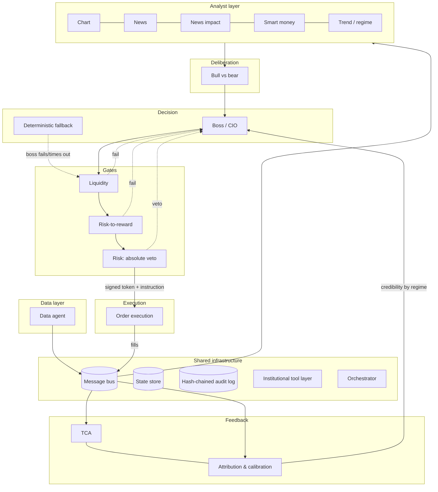
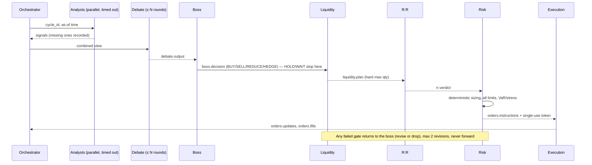

# Architecture: Multi-Agent AI Trading System

Status: **Phase 7 done** (restartable daily paper-trading service, attribution feedback,
notifications, paper-to-live readiness), awaiting review. Operations: [OPERATIONS.md](OPERATIONS.md).
Phase reports: [PROGRESS.md](PROGRESS.md).
Scope assumed for Phase 1: NSE cash plus F&O, swing horizon, Zerodha Kite Connect, Python 3.11+.
Every assumption is listed in [DECISIONS.md](DECISIONS.md) and is config-driven.

---

## 1. Principles and where each one is enforced

| # | Principle | Enforcement mechanism | Verified by |
|---|-----------|-----------------------|-------------|
| 1 | LLMs research and judge; they never sit in the execution hot path or do arithmetic | Agent specs mark LLM agents, which cannot publish on gate, risk or order topics (`TOPIC_PUBLISHERS`). The boss outputs a *risk-budget fraction* and deterministic sizing computes quantities | `test_agent_registry.py::test_llm_agents_never_touch_gates_or_orders`, `test_unauthorised_publishers_are_rejected` |
| 2 | Risk limits, sizing and execution are deterministic | Liquidity, R:R, risk, execution and orchestrator are `DETERMINISTIC`. Limits are validated on load (`config/settings.py`) | `test_gates_and_execution_are_deterministic`, `test_config.py` |
| 3 | Everything logged immutably and replayably | Every envelope, LLM call (full prompt, model, seed), tool call, config snapshot and human action goes to a hash-chained append-only log (`audit/chain.py`). The bus audits before delivery, and `ToolRunner` audits every call, failures included | `test_audit.py`, `test_bus.py`, `test_runner_audits_success_and_failure` |
| 4 | Point-in-time correctness | Envelope requires `event_time <= available_at <= produced_at`. The bitemporal store (`storage/pit.py`) reads as of `available_at`. Corporate actions are adjusted only once known. Pivots carry `confirmed_at` | `test_lookahead_survivorship.py`, `test_pit_store.py` |
| 5 | External text is untrusted | Strict schemas with `extra="forbid"`. Claims must quote a source document. Prompts wrap external text in data blocks. Outputs must parse or are discarded | `test_news_schemas.py`, `test_free_text_payload_is_rejected` |
| 6 | Safe degradation | Every spec declares a `FailureMode`. Missing agents apply limit multipliers. Safety-critical components `FREEZE` | `test_safety_critical_components_freeze_on_failure`. Phase 5: failure-injection tests |
| 7 | Staged rollout | `stage` in config; paper/live require durable backends; risk rule `STAGE_NOT_PERMITTED` | `test_paper_and_live_need_durable_backends` |

## 2. Layers and decision flow



### Decision cycle



**Failed gates.** A rejection at liquidity, R:R or risk goes back to the boss as a request to revise
or drop. `revision_of` and `revision_number` link the attempts. The revision cap is 2, after which
the decision becomes WAIT.

**HOLD and WAIT** produce no instructions (enforced in `UnsignedInstruction`). HOLD keeps
existing positions and their broker-side protective stops.

## 3. Components

| Agent | Kind | Publishes | Failure mode |
|-------|------|-----------|--------------|
| Data | deterministic | `data.*`, `risk.alerts` | FREEZE (data failure alert) |
| Chart | deterministic | `signals.chart` | SKIP (no levels → R:R cannot pass) |
| News | hybrid (LLM extraction) | `news.events`, `news.risk_flags` | SKIP (calendar flags still apply) |
| News impact | deterministic | `news.impact` | SKIP (generic stress scenarios) |
| Smart money | deterministic | `signals.smartmoney` | SKIP |
| Trend / regime | hybrid | `regime.outlook`, `news.risk_flags` | FALLBACK (regime UNKNOWN, stricter multiplier) |
| Debate (bull, bear) | LLM | `debate.output` | SKIP (boss conviction capped) |
| Boss | LLM | `boss.decision` | FALLBACK (rule set, ≤ 50% risk budget) |
| Liquidity | deterministic | `liquidity.plan` | BLOCK_TRADE |
| Risk-to-reward | deterministic | `rr.verdict` | BLOCK_TRADE |
| Risk | deterministic | `risk.approval`, `orders.instructions`, `risk.alerts` | FREEZE (nothing can be approved) |
| Execution | deterministic | `orders.updates`, `orders.fills`, `risk.alerts` | FREEZE |
| Orchestrator | deterministic | `system.heartbeat`, `risk.alerts` | FREEZE |
| TCA, attribution | deterministic | `tca.results`, `feedback.scores` | SKIP |

The full contracts (responsibility, consumed and published topics, tools, timeouts, metrics) are
the `SPEC` objects in each package, collected in `agents/registry.py`.

**Why most analysts are deterministic.** Chart structure, event studies, flow scores and
liquidity are numeric. LLMs are used only where language or judgment is the actual job: news
extraction, regime narrative, debate and the CIO decision. This keeps cost, latency and
non-determinism where they add value.

## 4. Communication

**Envelope** (`schemas/envelope.py`). Every message carries: `message_id`, `schema_version`,
`topic`, `agent_id`, `cycle_id`, `causation_ids`, `event_time`, `available_at`,
`produced_at`, `priority` and a typed `payload`. The payload is a discriminated union on `kind`.
The envelope validator enforces:

- the payload type matches the topic;
- the publisher is authorised for the topic (authority hierarchy);
- `event_time <= available_at <= produced_at` (no lookahead);
- `risk.alerts` are always `INTERRUPT` priority;
- the schema major version is compatible.

**Topics:** `data.bars`, `data.corporate_actions`, `data.quality`, `signals.chart`,
`signals.smartmoney`, `news.events`, `news.risk_flags`, `news.impact`, `regime.outlook`,
`debate.output`, `boss.decision`, `liquidity.plan`, `rr.verdict`, `risk.approval`,
`risk.alerts`, `orders.instructions`, `orders.updates`, `orders.fills`, `tca.results`,
`feedback.scores`, `system.heartbeat`.

**Delivery** (`bus/interface.py`). At-least-once delivery, so consumers dedupe on `message_id`.
Interrupts jump the queue. Ordering is guaranteed per topic only. Publishing writes the audit log
first and validates the envelope; an invalid envelope is never delivered. Backends: in-memory for
tests and backtests, Redis Streams (consumer groups) for paper and live.

**Patterns.** Broadcast for context (regime, risk flags). Request/response for gates, correlated
by `decision_id` and `cycle_id`. Interrupts for alerts and the kill switch.

## 5. Approval tokens and the no-bypass guarantee

1. The risk agent builds the `UnsignedInstruction` itself: approved quantity, liquidity plan,
   protective stop and idempotency key.
2. It computes `digest = sha256(canonical_json(instruction))` and issues an `ApprovalToken`
   containing `token_id`, `decision_id`, `instruction_digest`, `issued_at`, `expires_at`
   (TTL from `limits.execution.approval_token_ttl_seconds`, 16 h by default: how long the
   approval may wait for execution to redeem it), `key_id`, and an HMAC-SHA256 `signature`
   keyed by `AITRADER_RISK_SIGNING_KEY`. The instruction itself is valid until the close of
   the next weekday session (§22), so a Friday-evening approval trades on Monday.
3. `OrderInstruction` refuses to construct if the token's digest or decision does not match. Any
   change to quantity, price, side, stop or key after approval invalidates it (tested).
4. Execution verifies the HMAC and expiry, then atomically consumes `token_id`
   (`StateStore.consume_token`) and claims the `idempotency_key` before any broker call.
5. Only the execution package talks to a broker. `test_no_bypass.py` fails CI if any module
   outside `execution/` imports the live adapter or the order-request types, or calls a
   broker's place or cancel methods. Every broker call goes through `AuditedBroker`, which
   records the request and the response or error in the audit log.
6. The kill switch is a `risk.alerts` interrupt (`KILL_SWITCH`). Engaging it writes the freeze
   to the state store directly, so it works with the bus down. Execution cancels resting entry
   orders and refuses new entries, and keeps exits and protective stops. Only a human can
   release it (`clear_freeze(cleared_by_human=True)`), and the file switch only once its file
   is gone. Details in §20.

## 6. Orders

- State machine: `pending → placed → partially_filled → filled`, with `cancelled` and
  `rejected` as terminal states. The order book enforces it on every update
  (`IllegalTransitionError`), in memory and in Postgres.
- Each child order's broker tag is a deterministic 20-character hash of the instruction id
  and slice (Kite's tag limit). After a lost acknowledgement, execution looks the order up by
  tag and adopts it. If the lookup also fails, it never re-sends: the child is marked
  "outcome unknown" and trading freezes until a sync finds or rules out the order.
- Fills are booked once per `broker_trade_id`.
- Reconciliation compares the fill ledger with broker positions and open orders after every
  session (paper) or every `reconciliation_interval_seconds` (live). Any difference, or a
  trade or order the system did not place, raises `RECONCILIATION_MISMATCH` and freezes.
- Sanity caps: order value (slicing), order rate (token bucket at the broker OPS limit), price
  deviation from the last price, the price band, margin, freeze-quantity slicing for F&O.
  Market orders are disabled.

## 7. Point-in-time data

- **Bitemporal storage.** Every record keeps `event_time` (when it happened or was published at
  the source), `available_at` (when the system could first know it, including vendor and exchange
  publication lag) and `ingested_at`. Reads are always `as_of(available_at <= t)`.
- **Lagged sources get true availability.** FII/DII and participant OI are published after the
  close. Shareholding data is quarterly with a filing lag. Fundamentals become available at the
  filing timestamp, not the period end.
- **Corporate actions** are applied as of the backtest clock. A split announced after `t` must
  not adjust prices seen at `t`. `Bar.adjustment_factor` records what was applied.
- **Survivorship.** Historical index and universe membership is used, with delisted and renamed
  symbols mapped through `CorporateActionType.DELISTING` and `SYMBOL_CHANGE`.
- Phase 2 and 3 add explicit tests: a planted future record is never visible to an as-of read,
  backtest results are unchanged when future data is deleted, and delisted names stay in the
  universe on dates they traded.

## 8. LLM usage

- Models are pinned by exact id in `system.yaml`. `LlmConfig.require_pinned()` refuses
  placeholders and `*-latest` aliases before any LLM agent starts. Temperature defaults to 0.
- Prompts are versioned files in `src/aitrader/prompts/` and never edited in place. Every call
  logs the prompt id, version, hash, full rendered text, seed, tokens and cost (`LlmCallRecord`).
- Output must parse into the agent's schema. An unparseable output counts as an agent failure,
  never as a retry-until-it-agrees loop.
- External text appears only inside delimited data blocks. Schemas have no free-text
  "instruction" channel, and the extracted claims must quote the source span. That span is
  verified against the stored document by a deterministic tool (`news.verify_excerpt`).
- Numbers in LLM outputs must reference tool calls (`EvidenceKind.TOOL_CALL`). The boss cannot
  emit a quantity, only a `risk_budget_fraction` in [0, 1].
- Budgets: a per-cycle call cap and a daily USD cap. Breaching a budget degrades to the
  deterministic fallback.

## 9. Degradation matrix

| Failure | Behaviour |
|---------|-----------|
| One analyst times out | Cycle proceeds; limit multiplier ×0.75 per missing agent; no new entries below 3 live analysts |
| Trend agent missing | Regime `UNKNOWN`, multiplier ×0.5, exposure targets cannot rise |
| Debate missing | Boss decides, conviction capped |
| Boss fails or times out | Deterministic fallback, ≤ 50% risk budget, flagged `used_fallback` |
| Liquidity or R:R missing | Trade dropped |
| Risk agent down | Nothing can be approved, so no new orders; freeze alert on heartbeat loss |
| Data feed stale | `DATA_FAILURE` freeze for new entries; broker-side stops remain |
| Broker disconnect | Freeze; on reconnect, reconcile before unfreezing (human clears) |
| Reconciliation mismatch | Freeze; human clears |
| Duplicate or replayed message | Deduped on `message_id`; instruction replays rejected by single-use token and idempotency key |
| Drawdown breach | Daily: freeze new entries for the day. Total: freeze and run the flatten runbook. Human clears |

## 10. Risk framework

Limits live in `config/limits.yaml` and are validated for coherence on load (for example,
daily < total drawdown and net ≤ gross). They cover:

- per-trade risk (1%, hard cap 2% in code) and position (10%);
- gross and net exposure, sector, correlation cluster, leverage and number of positions;
- daily and total drawdown (3% / 10%), with progressive tightening from 50% of a limit;
- liquidity (≤ 5% ADV, participation ≤ 10%, ≤ 1 day to liquidate);
- VaR and CVaR at 99%, 1 day;
- minimum R:R per setup and minimum stop distance in ATR;
- event-window entry blocks;
- exposure changes of at most 20% per cycle.

Human approval is required above 0.5% risk, for new instrument types, and inside event windows.

## 11. Feedback loops

- **TCA** (Phase 6). Realised versus estimated cost per instruction (`estimation_error_bps`).
  The readiness report compares the two. The impact coefficient is still recalibrated by
  hand, from that evidence, not automatically.
- **Attribution** (Phase 7). Hit rate and IC per agent (Brier score for the trend agent), by
  the regime the signal was issued in, shrunk toward 0.5. It publishes `credibility`, which
  the boss's consensus weights read.
- **Setup EV drift** (Phase 7). Realised R-multiples of closed paper trades feed the R:R
  agent's setup statistics, which is how paper trading supplies the measured edge.
- **Boss discretion** (not yet wired). The discretion tracker exists. Recording the boss
  against the consensus baseline needs counterfactual returns per decision, and is open.

## 12. Staged rollout

`backtest → paper → live_human_approval → live_auto`. The stage is config, and the risk agent
refuses orders the stage does not permit. Each promotion needs explicit owner sign-off and the
exit criteria in DECISIONS.md. Paper and live refuse in-memory backends.

## 13. Repository layout

```
trading/
  config/            system.yaml, limits.yaml (no secrets)
  docs/              ARCHITECTURE.md, DECISIONS.md
  src/aitrader/
    schemas/         every message and tool schema (Phase 1, done)
    config/          typed config loader and validation (Phase 1, done)
    agents/<name>/   one package per agent (Phases 2–5)
    bus/             contract, in-memory and Redis Streams backends
    state/           contract, in-memory and Postgres state store and order book
    audit/           hash-chained audit log
    tools/           institutional tool layer (Phase 2)
    backtest/        event-driven backtester (Phase 3)
    orchestrator/    decision cycle (Phase 5)
    execution/       execution agent, paper broker, Kite adapter, checks, kill switch (Phase 6)
    paper/           runner (Phase 6); daily service, checkpoints, feed, readiness, CLI (Phase 7)
    feedback/        TCA agent (Phase 6), attribution agent (Phase 7)
    notify/          Telegram notifications and the notification agent (Phase 7)
    monitoring/      dashboard (Phase 6)
  deploy/            Dockerfile, docker-compose (Redis, Postgres, service), systemd timer
    prompts/         versioned prompts
  tests/
```

## 14. Tool layer

66 registered tools (`tools/catalogue.py`). Each is a pure function. Its Pydantic input
model is derived from the signature, so unknown fields and NaN/inf inputs are rejected, and it
returns a Pydantic output model. A registry self-test runs every tool's example twice and checks
determinism and JSON-safe output.

| Domain | Implemented (Phase 2) | Later |
|--------|-----------------------|-------|
| `stats` | OLS, rolling β/ρ, Engle-Granger cointegration, GARCH(1,1), ARIMA, Markov-switching regimes (filtered, no lookahead), change points, event study, Brier (binary and multiclass), IC | factor models (Phase 4) |
| `attribution` | beta-binomial credibility shrinkage | credibility weights, weighted consensus (Phase 5) |
| `risk` | historical, parametric (Cornish-Fisher) and Monte Carlo (Student-t, seeded) VaR/CVaR; drawdown and tail metrics; stress tests; exposure decomposition | — |
| `derivs` | Black-Scholes and Greeks, implied vol, CRR binomial (American), IV percentile, smile skew, term structure, PCR, max pain, OI walls, dealer GEX, multi-leg payoff, barrier-hit and terminal probabilities | IV surface fitting, OI build-up (Phase 4) |
| `micro` | spread/depth/imbalance, square-root impact, Almgren-Chriss, VWAP/TWAP, TCA, liquidation horizon | volume curves, slicer (Phases 5–6) |
| `costs` | Indian cost model with dated schedules (`config/costs.yaml`), round-trip costs | — |
| `ta` | ATR, swing pivots, market structure and failed breakouts, S/R clustering, anchored VWAP, relative strength, volatility state, volume profile, gaps, timeframe alignment | — |
| `sizing` | fixed-fractional (lot-rounded, cost-aware), vol-target, fractional Kelly | — |
| `portfolio` | risk parity, HRP, constrained mean-variance (name, sector and turnover caps), Black-Litterman | — |
| `fundamentals` | Piotroski, Beneish, two-stage DCF | statement parsing, revisions, surprises (needs a data source) |
| macro | — | yield curve, rate sensitivity (needs a data source) |
| `validation` | probabilistic and deflated Sharpe, Monte Carlo trade resampling, return statistics | — |

Deterministic pipelines such as the data agent call library functions directly and audit at
the envelope level. LLM agents (Phase 4+) can reach tools only through `ToolRunner`.

## 15. Backtester

`backtest/engine.py` runs any `Strategy` (a reference baseline now; the agent chain in
Phase 5) through this timeline for every session *d*:

1. **Before the open:** corporate actions with ex-date *d* are applied to holdings and to pending
   orders (splits and bonuses rescale quantity, price, stop and target; dividends are credited).
   Delisted positions close at their last close; expired futures settle at theirs.
2. **At the open:** orders decided after the previous close fill at *d*'s open. Each fill gets:
   - square-root slippage, estimated at decision time from data available then;
   - a cap at 10% of *d*'s volume, with any shortfall reported as a partial fill;
   - a cash check for cash-segment buys;
   - the cost schedule in force on *d*.
3. **During the session:**
   - a gap through a stop fills at the open, not at the stop;
   - a bar that spans both stop and target is assumed to hit the stop;
   - targets fill at the target level.
4. **At the close:** positions are marked to *d*'s close.
5. **After EOD publication (20:00 IST):** the strategy decides through a `PitView` that has no
   way to ask for data after the decision time.

**Guarantees, all tested:**
- results are bit-identical whether or not data after the end date exists (`run_digest`);
- runs are deterministic;
- `final = initial + Σ trade net P&L + dividends`;
- costs match the dated schedule.

Cash-segment shorts and position flips are rejected.

**Walk-forward** (`backtest/walkforward.py`):
- parameters are chosen on each training window only, with an optional embargo, then run on
  the following unseen window;
- the stitched out-of-sample curve is judged with the deflated Sharpe ratio, using the number
  of parameter sets tried and the variance of their Sharpe ratios;
- a test checks the selection cannot see the test window.

**Performance:** `MarketData.for_backtest` serves the immutable store from memory with
identical as-of semantics; a property test checks it against SQL. One 5-symbol, 240-session
run takes about 0.6 s.

**Backfill:** `python -m aitrader.backtest.backfill <dir>` loads NSE files by their file names,
audits each file (SHA-256, rows written) and is idempotent.

## 16. Analyst agents (Phase 4)

| Agent | Implementation | Inputs it can use today |
|-------|----------------|-------------------------|
| Chart | Deterministic. Monthly and weekly bars are resampled from daily, and a period still in progress is excluded. It reports per-timeframe structure, alignment with explicit conflicts, setups (breakout, pullback, mean reversion), structural stop and targets, relative strength vs NIFTY, volume point of control and unfilled gaps | Adjusted daily bars |
| News | Deterministic pipeline: clustering, entity linking by symbol and name, rules, quote verification, novelty, half-life, scheduled-event flags. LLM extraction is optional, and its output is accepted only after quote, symbol and date verification | Any `RawDocument` source (no connector yet) |
| News impact | Market-model event study (1d/5d), volume and volatility shocks, sector-peer contagion, overlapping events, and a reaction library by event type and regime with a stress quantile for the risk agent | Daily bars, security master sectors |
| Smart money | Futures-chain OI build-up, persistence, crowding and divergence per stock; FII index-futures positioning from participant OI; nearest-expiry PCR, max pain and OI walls | F&O bars with OI, participant-OI file |
| Trend | A transparent scenario rule over regime (HMM, gated on distinct volatilities), trend, breadth and VIX. Calibrated softmax (temperature and shrinkage) gives scenario probabilities; rate-limited exposure, sector tilts and macro event flags | NIFTY and sector indices, India VIX, universe bars, `config/events.yaml` |

**LLM layer** (`llm/`):
- provider-neutral client with an Anthropic adapter that uses structured outputs and sends no sampling parameters;
- versioned prompt files;
- fencing of untrusted text, which neutralises any attempt to close the data block;
- a structured caller with per-cycle call caps and a daily cost budget;
- every call, including failures, refusals and over-budget calls, audited with its full prompt, model, prompt hash, tokens and cost;
- LLM output must validate against a strict schema or it is discarded.

Agents refuse to start an LLM path until model ids and their prices are pinned in config.

**Offline evaluation** (`evaluation/`, CLI `python -m aitrader.evaluation.run`):
- agents are replayed point in time and scored on what followed: hit rate and IC against
  always-long and zero baselines; R-multiples per setup, with stop-first fills and levels
  rescaled to the outcome path's price basis; multiclass Brier against uniform and
  climatology;
- trend calibration (temperature and shrinkage) is fitted on a training window only.

## 17. Decision chain (Phase 5)

`orchestrator/cycle.py` runs one cycle:
1. Analysts run under per-agent timeouts. A failure or timeout is isolated and shrinks limits
   by `limit_multiplier`: ×0.75 per missing agent, ×0.5 more when the trend agent is missing.
   The multiplier also includes the regime's exposure view and drawdown tightening.
2. Candidates are held positions plus instruments with a chart setup.
3. For each candidate: debate → boss → liquidity → R:R → risk.
   - A failed gate goes back to the boss to revise (the LLM boss) or wait (the fallback), at
     most twice.
   - Every message is published with causation links and a deterministic id, so a cycle
     replays identically and every order traces back to its analyst inputs.

The agents:
- **Boss.** The deterministic fallback (the default while models are unpinned) buys only an
  aligned long chart setup when the credibility-weighted consensus is at least 0.25 and
  agreement at least 60%, using at most half the risk budget. It exits or reduces holdings
  when consensus turns negative, and never opens shorts. The LLM boss's output is validated:
  allowed actions only, budget within the discretion cap, the chart stop as invalidation.
  Otherwise it falls back. A discretion tracker shrinks the cap when the boss
  underperforms the consensus baseline.
- **Debate.** Bull and bear take capped rounds. Every point must cite a real message id; the
  debate is skipped without an LLM.
- **Liquidity.** ADV, square-root impact with an assumed spread (no order book yet), and a
  regime: normal, thin, stressed, circuit-locked or expiry. The maximum quantity is 5% of
  ADV, and 0 when circuit-locked. The algorithm is marketable limit, TWAP, POV, or iceberg
  above the freeze quantity.
- **R:R.** Blended targets, costs at the planned size, and P(win) blended from measured
  setup history with a no-edge prior (zero-drift barrier). Under that prior EV is exactly
  minus costs, so **nothing trades without a measured edge**: seed `SetupStats` from an
  offline evaluation (`SetupStats.from_evaluation`) or a paper-trading record. Gates: EV,
  minimum R:R per setup, stop noise, event risk, gap risk, missing levels.
- **Risk.** Sizes the order itself and checks 17 rules on the portfolio after the trade:
  per-trade risk, position, open positions, gross/net, sector, correlation cluster,
  leverage, daily/total drawdown, liquidity, events, VaR/CVaR, an index-shock stress test,
  freeze, analyst coverage, gates passed, human approval in live stages. It then signs the
  exact instruction. A freeze blocks entries but never exits.
- **Tokens.** HMAC-signed, digest-bound, expiring, single-use, with the idempotency key
  claimed atomically. `backtest/chain.py` verifies every instruction exactly as execution
  will before the engine sees it, so backtests exercise the same no-bypass path.

## 18. Known limitations (as of Phase 5)

- **Edge has to be supplied.** With empty setup history the chain correctly trades nothing.
  Real setup statistics must come from an offline evaluation on an earlier window of real
  data (still blocked on data access).
- **Only the deterministic boss is exercised end to end.** The LLM boss and debate are tested
  with a scripted client only.
- **Universe-scale speed.** About 0.15 s per cycle for 3 instruments; chart analysis costs
  ~0.04 s per instrument. NIFTY 500 over ten years needs caching or vectorisation
  (roughly 30× work), or backtests will take hours.
- **Risk model simplifications.** Correlation clusters and VaR use 250 days of
  historical returns. The stress test is a single index shock (beta-weighted); news stress
  quantiles exist but are not yet wired into it. Margin for F&O is not modelled.
- **Spread is assumed** (10 bps) until order-book data is available; impact coefficients are
  not yet calibrated by TCA (Phase 6 onward).
- **Realised-R feedback into `SetupStats` isn't wired from engine trades yet;** the attribution
  loop is Phase 7.

## 19. Known limitations carried from Phase 4

- **Analysts are only evaluated on synthetic markets.** On planted trends the chart agent
  shows positive IC and hit rate, and the calibrated trend agent beats a uniform forecast out
  of sample. On a market with a deterministic short cycle, the chart agent's daily breakout
  readings had negative IC: breakouts at cycle peaks are followed by the scripted pullback.
  Real performance is unknown until NSE history is loaded.
- **The trend agent's calibration defaults (temperature 2.5, shrinkage 0.2) are not fitted to
  real data.** Uncalibrated, the rule was overconfident and scored worse than uniform; refit
  with `evaluation.calibration.calibrate_trend` on real history.
- **LLM paths are untested against a live model.** Model ids are unpinned by default, and the
  tests use a scripted client. The trend agent has no LLM component yet; its spec allows one.
- **No news connector.** NSE/BSE announcement feeds need an adapter producing `RawDocument`s
  with true publication timestamps.
- **Smart money gaps:** no FII/DII cash flows, block/bulk deals, insider or promoter
  disclosures, or delivery % (none has a source). Smart Money Concepts patterns, optional in
  the spec, are not built.
- **No intraday bars:** no 5-minute or 1-hour event windows, and no intraday entry timing.
- **Participant-OI availability time (20:00 IST) is an assumption.**

### Carried over from Phase 3

- **No historical data loaded yet.** Every backtest so far runs on synthetic markets. The NSE
  archive host is still refused by this session's network gateway.
- **Fill model:** daily bars only; next-open fills; one slippage model for all names. Futures
  margin and leverage are not simulated (cash is checked for the cash segment only).
  Dividends are credited on the ex-date, not the payment date.
- **Option expiry** settles at the last traded price; exercise STT is not simulated.
- **Pre-2023 costs** are conservative approximations, and results using them say so
  (`approximate_costs_used`).
- **F&O history before July 2024** needs a legacy F&O parser plus lot-size history (not built).

From earlier phases:

- **NSE formats (UDiFF, index close, legacy cash) are unverified against live files.** This
  session's network gateway still refuses nsearchives.nseindia.com. The parsers follow NSE's published UDiFF and index-close layouts
  and fail closed on missing columns, but they must be run once against real files.
- **Availability times are conservative policy, not observed.** EOD files are stamped 19:00
  IST. The same rule applies in backtest and live, so the two cannot diverge.
- **Corporate actions:** splits, bonuses and dividends are adjusted. Rights issues, mergers and
  demergers are flagged for manual terms, not guessed.
- **No ingestion source yet** for corporate actions, the security master, index membership
  history, FII/DII, participant OI or fundamentals. Their schemas and storage exist; sourcing
  them is a decision for you (DECISIONS.md).
- **Cost rates** in `config/costs.yaml` come from public notices and must be verified against
  official circulars and the broker tariff. Pre-October-2024 exchange charges approximate the
  slab structure with its top slab.
- **PIT storage** keeps payloads as JSON in one DuckDB table. Backtests read through the
  in-memory cache, and writes are batched. A full NIFTY 500 × 10-year run has not been
  benchmarked yet.

## 20. Execution and paper trading (Phase 6)

**Execution agent** (`execution/agent.py`). For each instruction it receives on the bus:
1. It ignores ids already in the order book.
2. It verifies the token: signature, key, digest, decision and expiry. It then consumes the
   token and claims the idempotency key atomically. A replay raises `TokenReplayError` and is
   ignored. A forgery raises `TokenForgeryError`, is rejected and freezes trading.
3. It runs the pre-trade checks (`execution/checks.py`) against a live quote, margin and broker
   positions:
   - tradable instrument, no market orders, not expiring before it can trade;
   - the freeze (entries only), no cash shorts;
   - price band, fat-finger deviation, margin;
   - no flipping a position; exits no larger than the position.
4. It slices with `micro.slicer`: strictly below the freeze quantity, within the order-value
   cap, and spread over the horizon for TWAP/VWAP/POV.
5. It places each child idempotently under the rate limiter. Outside market hours children
   go in as after-market orders.

**Protection.** Every open position is covered by broker-held protective orders: Kite GTT,
a single stop or a two-leg OCO. They sit at the stop and first target the risk agent signed.
- The stop is a limit order once triggered, `protective_stop_limit_bps` (2%) past the trigger.
  A gap beyond that leaves it unfilled. Execution then raises an alert, freezes entries and
  re-arms the stop.
- An exit first cancels enough protection that stops plus exits never exceed the position, so
  a stop and an exit cannot both sell the same shares. Remaining quantity is re-protected after
  partial exits.

**Sync and reconciliation.** `sync` maps broker states onto the order state machine, books
each trade once as a `Fill` and tops up protection. `reconcile` compares the ledger with the
broker.

**Kill switch** (`execution/killswitch.py`):
- Manual: `engage()`.
- File: creating `broker.kill_switch_file` (default `run/KILL`) engages it, and a file whose
  text contains "flatten" also flattens.
- Automatic: execution freezes on three consecutive broker failures, unknown placement
  outcomes, reconciliation mismatches, refused or unfilled stops and failed authentication.
  The risk agent freezes on drawdown breaches.
- Flattening never bypasses the risk agent. `RiskAgent.flatten_instructions` signs one exit
  per holding, with ids derived from the alert, and those exits pass through execution like
  any other instruction.

**Brokers** (`execution/broker.py` contract):
- `PaperBroker` simulates the exchange on daily bars. Queued orders trade at the open, and
  stops and targets are checked against the open and then the day's range (stop first). It
  applies a participation cap, slippage (half spread plus square-root impact) and dated Indian
  costs. Like a real broker it refuses limits outside the band, CNC sells of shares not held
  and orders without margin. Faults can be injected per method: "down", or "lost_ack" (the
  broker acts but the answer is lost).
- `KiteBroker` maps the contract onto Kite Connect v3: orders and AMO, trades, holdings plus
  net positions, margins, quotes, and GTT. It is built from the documentation and tested
  against recorded response shapes only.

**Durable backends:**
- `state/postgres.py`: state store and order book. Single use is enforced by primary keys
  across processes; child updates take a row lock and are checked against the state machine.
- `bus/redis_streams.py`: one stream per topic plus an interrupt stream read first. Consumer
  groups acknowledge after the handler, with per-group deduplication. A poison message goes
  to a dead-letter stream after three attempts.
- `system.backends()` picks them from `system.yaml`. Paper and live refuse the in-memory ones.
- A test runs the same paper window on Redis and Postgres and on the in-memory stack and
  requires identical fills.

**Paper runner** (`paper/runner.py`). One `run_day` per session on a simulated IST clock:

| Time | Step |
|------|------|
| 09:00 | kill-file check |
| 09:15 | open |
| 09:16 | sync (fills, protection) |
| 15:30 | session simulated |
| 15:31 | reconcile and TCA |
| decision time | kill check, then one decision cycle on the broker's portfolio |

Execution receives instructions only through the bus.

**Feedback and monitoring:**
- `feedback/tca.py` compares the fills of each finished instruction with the arrival price
  and the liquidity estimate.
- `feedback/live_scores.py` scores chart and smart-money signals against realised 5-session
  returns.
- `monitoring/dashboard.py` renders a self-contained HTML page. It shows status, headline
  numbers, equity, drawdown against its limit, exposure, positions with their stops, agent
  health, latency and accuracy, LLM cost per decision, TCA, fills and alerts, in light and
  dark themes, with a table view.

## 21. Known limitations (as of Phase 6)

- **Paper trading is a replay, not live.** The runner drives the paper broker from stored
  daily bars on a simulated clock. Live paper trading needs a wall-clock scheduler, live
  quotes and daily data ingestion (Phase 7), and real data is still blocked by network access.
- **The Kite adapter has never talked to Kite.** Status strings, holdings/positions netting,
  GTT payloads, the AMO window and error types must be checked against a live account. The
  daily access token needs Kite's interactive login.
- **Daily-bar execution model.** No intraday path, so fill timing inside the day, TWAP/VWAP
  schedules and intraday stop ordering are approximations. Slices of one instruction all
  trade at the same session open in paper mode.
- **Margin is approximated:** cash for delivery, a fixed 25% of notional for futures and
  short options. SPAN data is not wired.
- **Corporate actions on held positions are not simulated** by the paper broker or the
  ledger. A split on a held name would show up as a reconciliation mismatch (and freeze) in
  live trading, and a human would resolve it. The exchange's cancellation of orders and GTTs
  on ex-dates is not modelled.
- **Exit protection timing.** Between cancelling a stop and the exit filling, that quantity
  is protected only by the resting exit order. If the exit expires unfilled, the stop is
  re-armed at the next sync.
- (Superseded in Phase 7: the attribution agent replaced the monitoring-only accuracy view,
  and Telegram notifications are built.)
- **Lookups after a lost acknowledgement assume the broker's order book is consistent
  within the retry delay** (0.5 s, doubling). If an order surfaces later than that, a
  duplicate is possible in principle. Its trades would match no order in the book, so sync
  would flag a mismatch and freeze, but only once it trades.

## 22. Daily paper-trading service (Phase 7)

**Service** (`paper/service.py`, built by `paper/app.py` from config, run by
`python -m aitrader.paper`). Each step:
1. Ingests every due weekday's EOD files through the data agent; ingestion is idempotent.
2. Refreshes the cached point-in-time reader.
3. Runs each new session through `PaperTrader.run_day`.
4. Checkpoints, writes the dashboard and sends the daily summary.

A weekday without files is a holiday once a later session exists; until then the service
waits. Operations are in [OPERATIONS.md](OPERATIONS.md).

**Restart = continuation.** `PaperCheckpoint` holds what the durable stores don't:
- the paper broker's orders, trades, positions, protections, prices and cash;
- the runner's peak equity and pending flatten requests;
- the day records, TCA state, the engaged kill switch and already-reported unfilled stops;
- the attribution state and the trend agent's last exposure.

The file store writes atomically; the Postgres store keeps one row per run. A test stops a
run after 15 sessions, rebuilds every object, restores and continues. Fills, equity, closed
trades and agent credibility match an uninterrupted run exactly. Two changes made that
possible:
- The trend agent refits its regime model once per ISO week, on returns from before that
  week. The fit no longer depends on when the process started.
- The trend agent's exposure rate limit is checkpointed.

**Attribution agent** (`feedback/attribution.py`). It observes the bus: regime outlooks,
chart and smart-money signals, boss decisions, instructions and fills.
- **Signal scoring.** Each signal is scored once its outcome is known, never earlier, and
  never revised:
  - chart and smart money: sign against the 5-session forward return, for |score| ≥ 0.2;
  - trend: top scenario against the realised 20-session index move (±3%), plus a Brier
    score.
- **Credibility.** The beta-binomial posterior of the hit rate (prior 0.5, strength 20) in
  the current regime, or across all regimes when the current one has fewer than 10 scored
  calls. It is published as `AgentScore` on `feedback.scores` and written into the cycle's
  credibility map before each decision.
- **Round trips.** Trips are rebuilt from fills. A closed trip's R multiple is profit per
  unit over the initial risk at the signed stop. It is recorded in the R:R agent's setup
  statistics under the setup that triggered the entry; on restore the trips are replayed.

**Instruction validity.** An instruction is valid until the close of the next weekday
session. Before Phase 7 it was valid for 16 hours from approval, so approvals made on Friday
evening expired before Monday's open and execution refused all of them (found and fixed
here). The 16-hour approval-token TTL is unchanged: execution redeems a token within a
second of signing.

**Notifications** (`notify/`).
- Freezing and critical alerts are sent once, by alert id; releases are sent too.
- A summary follows each session.
- Telegram messages are plain text (no parse mode), so alert text cannot inject formatting.
- The bot token is scrubbed from kept errors.
- A failed send never interrupts trading.

**Readiness** (`paper/readiness.py`). The `rollout.paper_exit` criteria, checked on the
record: sessions, reconciliation, drawdown, slippage against the estimate, closed trades,
fills traced to tokens that verify offline, and not frozen. Shown on the dashboard and by
`python -m aitrader.paper readiness`.

**Operations safety:**
- `kill` freezes in Postgres at once and leaves the kill file for the service.
- `release` refuses while the file exists, clears every freeze and records the operator in
  `human_actions`.
- The kill switch notices a release made from another process.
- `execution/kite_check.py` exercises only the adapter's read calls, behind a transport that
  refuses anything but GET.
- The paper service audits every broker call: the execution agent wraps its broker when
  given an audit log, so no module outside `execution/` handles broker objects.

## 23. Known limitations (as of Phase 7)

- **No real data has flowed yet.** NSE archives are still unreachable from this
  environment. The service, feed and parsers are exercised on synthetic files in NSE's
  published formats. The first real run will be the first test of the parsers on live
  files (§19).
- **No universe source.** Index-membership history has no ingestion source, so the paper
  universe is `paper.watchlist` until one is chosen.
- **Live paper mode is EOD replay on the day.** The paper broker simulates each session from
  that day's bar after it is published. Fill timing within the day is approximated, as in
  §21.
- **The Docker image has not been built here.** Docker Hub refused the base-image pull
  (rate limit). The compose file validates, and the systemd timer schedules were checked
  with `systemd-analyze`.
- **A crash in the middle of a session** is not rolled back. The restart replays the
  session from the last checkpoint: fills dedupe by trade id, but protection records may
  disagree with the broker. Reconciliation freezes and a human checks.
- **Boss discretion is not fed.** Credibility and setup statistics are live; the discretion
  cap stays at its default.
- **Impact recalibration is manual.** The TCA evidence is reported, but coefficients are
  not changed automatically.
- **Holidays are inferred,** not read from an exchange calendar. An instruction approved
  before an unknown holiday expires untraded (safe).
